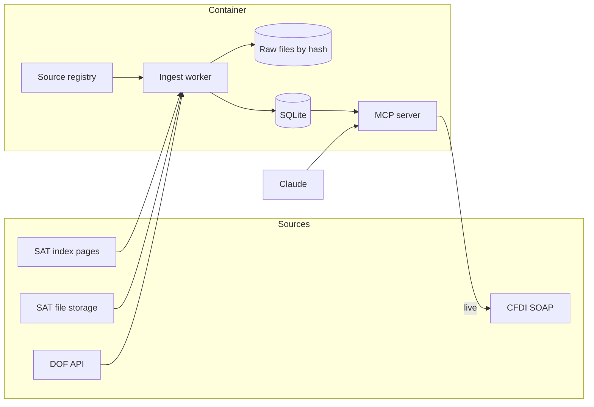

# SAT/DOF MCP connector: extraction and tool design

Draft 2 · 13 November 2026 · builds on [reporte_fuentes_y_requerimientos.md](reporte_fuentes_y_requerimientos.md) (25 October) · companions: [data_relationships.md](data_relationships.md), [glossary.md](glossary.md)

## Summary

Everything the connector needs can be fetched with plain HTTP requests. No browser, no Chrome extension and no manual steps are required, so extraction can be fully programmatic and repeatable.

- **The "Excel" problem is two different things.** The 22 taxpayer lists are text CSV files that the server mislabels as Excel. The SAT statistics are real binary Excel files (89 of them), and Bun reads them directly. Both were parsed today inside this repo's stack (Bun + TypeScript) without a browser.
- **The data groups into 8 topics**, which map to 14 tools: 9 in a first phase (lists, DOF notes, indicators, CFDI check) and 5 in a second (statistics, charities directory, CFDI catalogs).
- **The agent never receives duplicated data.** Deduplication runs when data is loaded, in six layers, and nothing is lost: a collapsed record keeps a count and its sources. The October files contain about 26,000 redundant rows and one list whose text is 65% repetition.
- **Yearly change is handled by a source registry**: one declarative entry per dataset, with file addresses discovered from the SAT index pages instead of written into code. Today's probes already found three addresses that moved or carry a date.
- **Main risk:** every probe ran from this Mac. The October report notes that a cloud environment could not reach the SAT file storage, so reachability from the real Docker host must be tested before anything else.

## What changed since the October report

The October report stays valid for the list contents, data-quality rules, DOF note endpoints and deployment options. Its requirements for the reverse proxy, TLS, the Anthropic IP allowlist and OAuth still apply unchanged. This document replaces its tool table (7 tools) and widens the scope beyond the 22 lists.

| Topic | October report | Today |
| --- | --- | --- |
| How files were fetched | Through Chrome, because the assistant's cloud environment could not reach SAT storage | `curl` from this Mac reaches every source directly |
| SAT scope | 22 lists on one page | 15 open-data pages: the 22 lists plus 89 Excel files, 20 yearly CSV reports and about 250 PDFs |
| DOF scope | Notes | Notes, editions and financial indicators (exchange rate, UDIS, TIIE) |
| List freshness | Snapshot of 25 October | 7 of the 22 lists have changed since. All seven are article 69 lists, re-uploaded on 4 and 12 November |
| Egress hosts | 3 | 5 required, 2 optional |

## What "deterministic" means here

The same downloaded bytes always produce the same rows. Three rules make that true:

1. **Raw bytes are kept.** Every download is stored unchanged, named by its SHA-256 hash. Any result can be reproduced later from the stored file.
2. **Parsers are pure functions.** A parser receives bytes plus a versioned profile and returns rows. It does not read the clock, the network or the database.
3. **No model and no browser in the path.** Claude only sees rows that are already in the local database. Extraction never depends on a model reading a page.

A parser that meets something it does not expect (a new column, a missing header) stops and keeps the previous data. It never guesses.

## Sources verified on 13 November 2026

All requests below were made with `curl` from this Mac, without cookies or a browser session. The first pass sent a browser User-Agent header; I then repeated one request per host with `curl`'s default header and with Bun's `fetch`, and got the same responses. No source checks for a browser.

| Source | Host | Format | Change signal | Measured |
| --- | --- | --- | --- | --- |
| SAT open-data index pages (15) | `www.sat.gob.mx` | Static HTML; links are in the raw HTML, no JavaScript needed | Compare the set of links | 6 to 86 KB each |
| Taxpayer lists (22) | `wu1agsprosta001.blob.core.windows.net` | CSV in Windows-1252, sent as `application/vnd.ms-excel` | `Content-MD5`, `ETag`, `Last-Modified` on `HEAD` | 80 MB in total (October) |
| SAT statistics (75 files) | Same storage host | Binary Excel 97–2003 (`.xls`) | Same as above | 27 MB for all 89 `.xls` files |
| Authorised charities directory, CFDI catalogs, yearly charity reports, 14 other `.xls` files | `omawww.sat.gob.mx` (plain HTTP) | `.xls` and CSV | `Last-Modified` and a versioned `ETag`; no `Content-MD5` | 19.7 MB took 17.8 s; the 48.8 MB CFDI catalog took 52 s |
| DOF notes and editions | `sidof.segob.gob.mx` | JSON; note body is HTML inside the `cadenaContenido` field | None; poll by date | 133 notes for 12 November in 0.54 s |
| DOF indicators | Same | JSON | None; poll by date | Under 1 KB per day |
| CFDI status service | `consultaqr.facturaelectronica.sat.gob.mx` | SOAP | Live query | Service description (WSDL) answers; no real query made |

Two optional hosts appear in links: `wu1aqauatsta003.blob.core.windows.net` (3 files) and `www2.sat.gob.mx` (40 PDF reports).

### Checks run in this repo's stack

- **Excel in Bun:** the SheetJS library read `IngresosTributarios.xls` (215 rows, numeric cells returned as numbers). No Python sidecar is needed.
- **Windows-1252 in Bun:** `TextDecoder("windows-1252")` decoded the raw 69-B "Presuntos" file with zero replacement characters, and maps bytes 0x80–0x9F correctly.
- **Golden comparison:** the raw "Presuntos" file still has the MD5 recorded in the October manifest. Parsing it gave 878 rows with 0 cell differences against `docs/sat_listas_utf8_2026-10-25/csv/sat_69b_presuntos.csv`.
- **CFDI catalog in Bun:** the 48.8 MB workbook has 28 sheets and parsed in 2.7 s, but the process used about 3.4 GB of memory. A reader that loads one sheet at a time (Python `xlrd`) read all 28 sheets with a peak of about 209 MB, so the cost comes from the library, not the file. Validity dates are present as Excel serial numbers, and the postal-code and neighbourhood catalogs are split across 2 and 3 sheets.
- **Encoding defect confirmed:** `Condonados_07_15.csv` contains 26 bytes with value 0x90, which Windows-1252 does not define. This matches the CP850 repair the October report describes.

### Evidence that addresses must not be hardcoded

- The list page links "Sentencias" twice: `AGR/03_02_26/Sentencias.csv` (uploaded 3 February) and `Documents_AGR/Sentencias.csv` (uploaded 4 November). The two files differ.
- The incumplidos statistics file moved from `AGR/03_02_26/` (October report) to `Documents_AGR/` (today).
- The CFDI catalog file carries its date in the name: `catCFDI_V_4_20261106.xls`.
- The RMF page redirects to `normatividad_rmf_rgce2026.html`, and budget files follow `ProyFinanPEF{year}.xls`.
- The link texts "Listado completo" and "Definitivos" appear under both 69-B and 69-B Bis, so link text alone does not identify a file.

## What can be extracted, by topic

| # | Topic | What it answers | Source and size | Phase |
| --- | --- | --- | --- | --- |
| 1 | Published taxpayers | Is this RFC or company on a SAT list, at what stage, since when, for how much | 22 CSV, 738,602 rows (October count) | 1 |
| 2 | DOF publications | What was published on a date; text of a note; RFCs named in 69-B, 69-B Bis and 49 Bis notices; recurring reference notices found by topic tag (weekly fuel-tax stimulus, inflation index, UDI tables, UMA) | DOF API, about 25,000 notes per year (20,940 from 1 January to 25 October) | 1 |
| 3 | Financial indicators | Exchange rate, UDIS and TIIE for a date or range | DOF API, 6 to 7 values per day | 1 |
| 4 | CFDI status | Is this invoice valid, cancellable, issued by a listed taxpayer | SOAP, live | 1 |
| 5 | SAT statistical series | Monthly or quarterly figures: taxpayer registry, returns and payments, invoicing, refunds, audits, litigation, collection, tax revenue, surveys | 60 distinct series files in `.xls`, sharing one layout | 2 |
| 6 | Directories | Is this organisation an authorised charity (donataria), with its RFC, address and authorisation notice | One 19.7 MB `.xls` (16,157 data rows for 10,507 organisations) plus 20 yearly CSV reports (2008–2026). I sampled one report: 1.8 MB, 36 columns of donations, income and expenses per charity | 2 |
| 7 | CFDI reference catalogs | What does a product, regime or usage code mean; is it in force | One 48.8 MB `.xls` with 28 sheets (52,518 rows in the product catalog alone), plus schema files | 2 |
| 8 | Regulations | Text of the RMF, its amendments and annexes | The DOF API returns only a "download the file" stub for the RMF main text and Anexo 1; other annexes arrive as HTML. Needs the DOF document endpoint or the PDFs on the SAT site, both untested | 3 |

**Catalogued but not ingested for now:** SAT spending projects (14 files), responses to information requests (7 files, 2015–2021), anonymised annual returns 2010–2015 (large archives), and about 250 PDF reports and studies. The registry lists them so a change is noticed, but no parser is written until someone needs them.

**Out of scope:** anything behind taxpayer credentials or a CAPTCHA (compliance opinion 32-D, tax status certificate, bulk RFC validation, tax mailbox). Notifications by "estrados" remain without a verified source, as in October.

### Layout count for the Excel files

All 89 `.xls` files are genuine binary Excel with one or two sheets. They fall into four layouts, which is the number of Excel parser profiles needed:

| Layout | Files | Shape |
| --- | --- | --- |
| Time series | 64: 58 in the statistics sections, 2 counts of information requests, and 4 older copies of audit files on a second host | Title in row 2, header starting in row 4 or 5 and spanning 1 to 4 rows, year and period columns, footer starting with "Fuente". Some columns are cumulative within the year, and three files change granularity partway through |
| Project tables | 14 | One row per project, different columns per year |
| Information-request responses | 7 | Free-text table |
| Dictionaries and technical notes | 4 | Not data; skip |

The charities directory is a fifth layout: 30 preamble rows (title, a legend of activity codes, a note), the header on row 31, then plain data rows with no banners among them.

## Architecture

One Docker image, two processes, one SQLite file on a volume.



- **Ingest worker:** the only writer. Runs on a schedule and performs seven steps per dataset: discover, fetch, store raw, parse, validate, deduplicate, load.
- **MCP server:** read-only. Answers from SQLite in milliseconds and keeps working when SAT or DOF are down. Only the CFDI check goes out live.
- **SQLite instead of PostgreSQL:** the data is small (the 22 lists are 80 MB raw), there is one writer, and Bun has a built-in driver. This removes one container. Name search needs SQLite's full-text index (FTS5). It works in Bun on this Mac; confirm it in the Linux image before committing to this.
- **Transports:** Streamable HTTP for Claude Enterprise, and stdio for local use and tests, from the same code.

### Source registry

The registry is the part that absorbs yearly change. Each dataset is one entry; adding a list or a new year is a data change, not a code change.

```ts
{
  id: "sat.69b.completo",
  topic: "contribuyentes_publicados",
  discover: {
    page: "https://www.sat.gob.mx/minisitio/DatosAbiertos/contribuyentes_publicados.html",
    hrefPattern: /Documents_AGAFF\/Listado_completo_69-B\.csv$/,
    linkText: "Listado completo",       // cross-check only
  },
  format: "csv",
  encoding: "windows-1252",            // browser-standard table: bytes it leaves undefined pass through
  parser: { profile: "csv-69b", version: 1, preambleRows: 2 },
  repairs: [],                          // e.g. ["cp850-fragments@1"] on the two 2007–2015 files only
  expect: { columns: 20, header: ["No", "RFC", "Nombre del Contribuyente", /* … */] },
  role: "load",                         // the four sub-lists are registered with role "cross-check"
  ignoreColumns: ["No"],                // running number: positional, restarts in each file
  identity: ["RFC", "Número y fecha de oficio global de presunción SAT"],
  invariants: ["69b_completo_equals_sum_of_parts"],
  schedule: { checkEvery: "1h", staleAfterDays: 45 },
}
```

Discovery compares the links on each index page against the registry and raises three kinds of alert:

- **Missing:** a registered pattern matches no link. The file was renamed or removed.
- **Ambiguous:** a pattern matches two links, as "Sentencias" does today. The entry must say which one wins.
- **Unknown:** a data link matches no entry. This is how a new list (as 49 Bis was in 2026) gets noticed.

**Repairs are declared per dataset.** A repair is a named, versioned correction such as the CP850 fix, applied only to the entries that list it. The October report applied that fix to the two 2007–2015 files and deliberately left source typos such as `ZU¥IGA` untouched. The raw value is always kept beside the repaired one, so a repair can be audited or withdrawn.

### Ingest pipeline

| Step | What it does | Fails safe by |
| --- | --- | --- |
| Discover | Reads the index page, resolves each entry to a current address | Keeping the last known address and alerting |
| Fetch | `HEAD` first; downloads only when the change signal differs | Retrying with backoff; resuming large files with `Range` |
| Store raw | Saves bytes under their SHA-256, compressed | Never overwriting |
| Parse | Bytes + profile → typed rows | Stopping on any structural surprise |
| Validate | Header matches, row count within threshold, invariants hold | Quarantining the download; previous data stays live |
| Deduplicate | Canonicalises cells, computes each row's identity and content hashes, collapses rows where both are equal and links them to taxpayers, notices and events (see Deduplication) | Stopping if the collapsed counts do not add up to the raw row count |
| Load | Replaces the dataset in one transaction and records what entered, left or changed | Rolling back the transaction |

### Change detection per host

| Host | Method | Suggested interval |
| --- | --- | --- |
| SAT file storage | `HEAD`, compare `Content-MD5`, fall back to `ETag` | Hourly (22 requests took 0.5 s in October) |
| `omawww.sat.gob.mx` | `HEAD`, compare `Last-Modified` and `ETag`; compute our own SHA-256 after download; timeout of 5 minutes | Daily |
| SAT index pages | Hash of the sorted link list | Daily |
| DOF notes | `/diarios/porFecha/{today}` then `/notas/{today}`; re-read the last 3 days once a day | Every 30 minutes, 06:00–22:00 Mexico City time |
| DOF indicators | `/indicadores/{date}` | Once a day after the morning edition |

The intervals are starting values. Hourly polling of the lists is cheap and gives the freshest data the source allows; the DOF has no change signal, so its interval is a trade between freshness and load on an API with no documented limits.

### Data model (sketch)

Keys follow the measured natural keys in [data_relationships.md](data_relationships.md).

- `dataset`, `download` (one row per stored file: hash, change-signal headers, fetch time, parser version, status).
- `contribuyente`: one row per RFC, with a canonical name and the spellings seen.
- `oficio`: one row per notice (normalised number, date, stage). The 69-B list has 785 distinct notices behind 61,325 cells.
- `lista_registro`: one row per identity and version, with the content hash, `rfc`, list, status or cause, dates, amount, state, a JSON column for list-specific fields, `occurrences`, `first_seen` and `last_seen`.
- `evento_69b`: one row per list record and stage, with the SAT and DOF notice numbers, the SAT page date, the DOF date and the sources that report it.
- `lista_cambio`: one row per record that entered, left or changed between two downloads. The source files carry no history, so this table is the only record of it.
- `dof_nota`, `dof_nota_rfc` (one row per note and RFC), `indicador`.
- Phase 2: `serie`, `serie_valor`, `donataria`, `cfdi_catalogo`.

## Deduplication

The agent must never receive the same record twice. Deduplication therefore runs in the ingest worker, and its result is what the database stores. Tools read records that are already deduplicated, so the same question always returns the same records. No tool is built before this layer exists.

### Where duplication comes from

Measured on the 25 October files and on live DOF notes:

| Kind | Evidence | Size |
| --- | --- | --- |
| Same rows in two files | The four 69-B sub-lists are row for row inside the complete list (15,013 of 15,013); same for 69-B Bis (3 of 3) | 15,016 redundant rows |
| Exact duplicate rows inside a file | Reducción de multas 11,089; 69-B complete list 26; Sentencias 17; Cancelados 2 | 11,134 rows |
| Repeated text | 69-B has 61,325 notice cells but 785 distinct notices; they are 65% of the file's characters | 2.9 MB, or 42 KB stored once |
| Same fact in two sources | A 69-B notice is in the SAT file and in a DOF note | Every notice published in both |
| Same list twice in one DOF note | Note 5801999 prints its 171 taxpayers in two tables | Twice per note |
| Two versions of one file | Sentencias has two links with different content; four audit statistics files have an older copy on a second host | 5 files |
| Same row across downloads | 97–100% of rows are unchanged from one download to the next | Most of every download |
| One taxpayer, several spellings | Names differ by spaces, punctuation or word order between lists | About a third of cross-list matches |

### Two rules

- **Nothing is lost.** Collapsing never discards information. A collapsed record keeps `occurrences`, the number of source rows it stands for, and the list of sources.
- **No guessing.** Records merge only when they are exactly equal after canonicalisation. Two different RFCs are two different taxpayers, even when they differ by one digit: they stay separate records, with no "possible match" flag and no fuzzy matching.

### Identity and content

Every row gets two hashes, both computed on canonical cells (trimmed, runs of whitespace and non-breaking spaces collapsed, RFC upper-cased) and both ignoring positional columns such as the running number `No`, which restarts in each file and shifts whenever a row is added:

- **Identity** says which thing the row is about. It is the hash of the key columns the registry declares (`identity`), or of the whole row where the list has no key.
- **Content** says what the row currently states. It is the hash of all its cells.

Two rows are duplicates only when identity and content are both equal. Equal identity with different content is never collapsed: inside one file it means the declared key is wrong, and the load stops; between two downloads it is a change, and it is recorded as one.

### Six layers

1. **Source.** Each fact is loaded from one file. For 69-B and 69-B Bis only the complete list is loaded; the sub-lists are fetched as a cross-check. Where two versions of a file are linked, the registry names the one that wins.
2. **Row.** Rows with equal identity and content become one record with `occurrences: n`.
3. **Taxpayer.** One `contribuyente` record per RFC. List records point to it. The 91 rows of 69-B with a suppressed RFC (`XXXXXXXXXXXX`) attach to no taxpayer, and their identity is the whole row without `No`: keying them on RFC and notice would wrongly merge them into 31 records. Only their exact copies collapse, leaving 65 records.
4. **Cross-source event.** A stage publication is one event, identified by the list record and the stage. It stores both notice numbers, because the SAT and the DOF number of the same stage differ in about 2% of rows. A DOF note attaches to the event when its notice number equals either one and the RFC is the same, so the SAT file and the DOF note never produce two events for one publication. Inside a DOF note an RFC counts once, however many tables repeat it. An RFC printed in a note with no matching list record stays a separate record whose only source is the note.
5. **Snapshot.** A record whose identity and content are unchanged is stored once, with `first_seen` and `last_seen`. A record whose content changed (a presumption that became definitive, a DOF date that was filled in) keeps its identity and gets a new version. `novedades_listas` reads exactly this: entered, left, changed.
6. **Response.** Results are grouped by RFC, then by list. Notices and sources appear once in a `referencias` block and are referenced by id. Pages are ordered by identity, so no record repeats across pages. A batch of RFCs is deduplicated before lookup. `leer_nota_dof` returns each taxpayer table once as rows and removes the tables from the text it pages. Every response states how many source rows were collapsed.

### Lists without a key

Reducción de multas, Cancelados and Sentencias have no column that identifies an event, and the file cannot tell a repeated fine from a repeated row. Exact duplicates there are collapsed into one record with its count and a note that the source repeats it. Totals are computed on distinct records and state the raw row count beside them: the amounts in Reducción de multas add up to 21.456 billion on raw rows and 21.247 billion on distinct ones.

### Tests for this layer

- No two current records in the database share an identity.
- The sum of `occurrences` equals the raw row count of the file.
- No file contains two rows with the same identity and different content.
- Loading the same file twice changes nothing.
- No identity appears twice in any tool response, including across pages.
- The 69-B sub-lists still equal the complete list.

## Tools

Tools follow the shape of the question, not the shape of the files: one tool serves all 22 lists, and one serves every statistical series. Names and descriptions stay in Spanish because users will ask in Spanish.

### Phase 1 (9 tools)

| Tool | Input | Returns | Topic |
| --- | --- | --- | --- |
| `estado_fuentes` | None, or a topic | Per dataset: last successful download, declared cutoff date, latest date found in the data, alerts | All |
| `buscar_rfc` | RFC | Every record in every list for that RFC (several when the taxpayer has several procedures), with status, dates, notices and amounts. Also searches RFCs extracted from DOF notices, because 49 Bis exists only there | 1, 2 |
| `buscar_nombre` | Company or person name | Ranked approximate matches with RFC and list | 1 |
| `revisar_proveedores` | List of RFCs (capped) | One consolidated result per RFC, over the same lists and DOF notices as `buscar_rfc` | 1, 2 |
| `novedades_listas` | Date range, optional list | RFCs that entered, left or changed stage | 1 |
| `publicaciones_dof` | Date range; optional issuing body, text, topic tag | Notes with code, title, issuing body and page | 2 |
| `leer_nota_dof` | Note code, optional page | Clean text in pages, with each taxpayer table returned once as rows instead of inside the text | 2 |
| `indicadores_dof` | Indicator and date or range | Values with dates | 3 |
| `verificar_cfdi` | UUID, issuer RFC, receiver RFC, total | Status, cancellability, listed-issuer flag | 4 |

### Phase 2 (5 tools)

| Tool | Input | Returns | Topic |
| --- | --- | --- | --- |
| `estadisticas_listas` | List, grouping (status, state, person type, year) | Counts and amounts | 1 |
| `catalogo_series` | Optional topic or text | Available series with unit, period and range | 5 |
| `consultar_serie` | Series id, date range | Values | 5 |
| `buscar_donataria` | RFC, name or state | Directory rows | 6 |
| `catalogo_cfdi` | Catalog name and code or text | Matching entries with validity dates | 7 |

Regulations (topic 8) have no tool yet. `publicaciones_dof` with a topic tag finds the RMF notes, but the API gives no text for the main resolution, so reading it needs the document endpoint first.

### Rules every tool follows

- **Read-only**, and declared as such in the tool annotations.
- **Provenance in every response:** a `fuente` block with dataset id, source address, download time, declared cutoff date and latest date found in the data. The October report showed that the two dates can differ by more than a week.
- **Typed input and output schemas**, with results returned as structured data as well as text.
- **No duplicates:** every record appears once per response, with shared notices and sources referenced by id (see Deduplication).
- **Amounts and dates as the source means them:** an amount of 0 or blank is "not disclosed", not zero. Article 69 dates are quarterly batch dates, and responses label them as publication dates.
- **No personal contact data:** the charities directory includes representatives' names, telephone numbers and e-mail addresses; `buscar_donataria` does not return them.
- **Bounded output:** limits and pagination on every list result. A single DOF note can be 3 MB of HTML, so `leer_nota_dof` returns cleaned text in pages.
- **Honest negatives:** "not found in the lists as of this date" is different from "clean". Responses say which lists were searched and what they cannot contain (91 rows with a suppressed RFC, 1,146 incomplete RFCs in one historical file).
- **Actionable errors:** an error states what to change in the input.
- **Third-party text is data.** DOF note bodies are stripped to text and returned as quoted content, never as instructions.

## Testing

| Layer | What it checks | When |
| --- | --- | --- |
| Parser unit tests | Each profile against raw-byte fixtures: preamble rows, quoted line breaks, Excel serial dates, date ranges, lowercase RFCs, the CP850 repair | Every commit |
| Parser output checks | The four automatic checks below | Every commit and every ingest |
| Determinism test | Parsing the same bytes twice gives identical row hashes | Every commit |
| Deduplication tests | The six tests listed under Deduplication | Every commit and every ingest |
| Tool contract tests | Each tool, against a small fixture database: input validation, output schema, presence of `fuente`, limits, no repeated identity | Every commit |
| Protocol tests | An in-memory MCP client lists the tools and calls each one | Every commit |
| Answer checks | Known questions with known answers: RFC `AAA120730823` is "Definitivo"; note 5801999 contains 171 RFCs; note 5793257 is a 49 Bis notice | Every release |
| Live canaries | `HEAD` on every registered address, the DOF endpoints for today, index-page link diff | Scheduled, outside CI |

### How parser output is verified without reading files by hand

The lists have up to 264,000 rows and the SAT re-uploads them every few weeks. A manual check of the output cannot be repeated or audited, so expected results are generated and cross-checked automatically:

1. **Continuity with the previous download.** Ignoring positional columns, the difference between two versions must consist of rows entering, rows leaving, and a small number of rows whose content changed. A parser fault shows up as thousands of altered rows; a real update shows up as additions and removals. The load step already computes this difference for `novedades_listas`.
2. **Structural rules on the raw file.** Every record has the header's column count, RFCs match their pattern, dates parse, category values belong to the known set, and the record count equals the count from an independent quote-aware scan.
3. **A second, independent parser.** The same bytes go through a reference implementation and must give identical cells. It must use the same Windows-1252 rule as the main parser: the CSD file contains one byte (0x8D) that Python's decoder rejects and the browser-standard decoder in Bun accepts.
4. **Recorded snapshots.** Once checks 1 to 3 pass, the output is saved automatically as the new expected file.

A person reads the short difference report, and is needed for one thing only: confirming what a column means when a new list or a new header appears.

Check 1 was run on 13 November against the seven lists that changed since October. Headers were unchanged in all seven:

| List | October rows | 13 November | Identical | Only in October | Only on 13 November |
| --- | --- | --- | --- | --- | --- |
| No localizados | 53,346 | 53,383 | 53,326 | 20 | 57 |
| Exigibles | 2,747 | 4,167 | 2,747 | 0 | 1,420 |
| Firmes | 264,209 | 264,783 | 256,120 | 8,089 | 8,663 |
| Cancelados | 184,837 | 185,320 | 184,621 | 216 | 699 |
| Sentencias | 610 | 611 | 610 | 0 | 1 |
| CSD sin efectos | 59,636 | 60,582 | 59,408 | 228 | 1,174 |
| Entes públicos omisos | 3,200 | 4,088 | 3,200 | 0 | 888 |

So the October conversion already verifies the parser on 97–100% of the current rows of these lists, without their original raw files.

### Fixtures

Fixtures must be the bytes as downloaded. The CSV files already in `docs/` are converted output, so they serve as expected results, not as inputs.

- **Raw and converted pairs:** 15 of the 22 raw files still matched the October hashes on 13 November and are saved (29 MB) in `docs/sat_listas_raw_2026-10-25/` with a manifest. They cover the 69-B, 69-B Bis, reductions, condonations and 2007–2015 layouts.
- **The other 7 lists** have no stored October raw file. Check 1 covers them, as the table shows.
- Large raw files should stay out of git and be fetched by hash into a local cache; small ones and trimmed samples can be committed.

## Scaling to yearly and unannounced changes

| Kind of change | Example | How it is absorbed |
| --- | --- | --- |
| File moved or renamed | `AGR/03_02_26/` → `Documents_AGR/` | Discovery resolves the new address; alert if the pattern no longer matches |
| Dated or yearly file names | `catCFDI_V_4_20261106.xls`, `ProyFinanPEF2026.xls` | Patterns with a date or year part; newest match wins |
| New column or reordered header | Any list | Validation stops the load; a new parser profile version is added and tested against the stored raw file |
| New list created by a reform | 49 Bis in 2026 | "Unknown link" alert, then a new registry entry |
| New rule set each year | RMF 2027 | Topic tags for DOF notes are data (issuing body + title pattern), reviewed each November–January |
| Source silently stops updating | Article 69 lagging its quarterly date | `staleAfterDays` per dataset, shown in `estado_fuentes` |

## Risks and unverified points

| Item | Status | What to do |
| --- | --- | --- |
| Reachability from the deployment host | Not tested; every probe ran from this Mac, and a cloud environment failed in October | Run the `HEAD` and DOF checks from the real server or VPS before building further |
| `omawww.sat.gob.mx` is plain HTTP and slow | Measured | Long timeouts, resumable downloads, own hash; treat content as unauthenticated |
| Reader for the 48.8 MB CFDI catalog | Measured: about 3.4 GB with SheetJS reading the whole workbook, about 209 MB with a reader that loads one sheet at a time | Choose the reader before phase 2: SheetJS limited to one sheet per pass (untested), or a small Python step in the ingest worker for this file |
| Charities directory may be stale | The `.xls` was last modified on 25 August 2025 | Check whether the SAT publishes a newer directory elsewhere; report its date in every answer |
| Yearly charity reports | 1 of 20 files sampled | Confirm the 36 columns are stable across years before writing the profile |
| SheetJS version | Tested with 0.18.5 from npm. I believe newer releases are distributed only from the vendor's own site; not checked | Confirm, then pin the version |
| Indicator codes | Confirmed by equal values in the Banco de México notes of two dates: 158 dollar, 159 UDI, 163 cost of funds in dollars (monthly), 165/166/174 TIIE 28/91/182 days, 175 funding TIIE. No endpoint returns the names | Keep the mapping as registry data and re-check it when a new code appears |
| RMF text | Not available as text in the DOF API for the main resolution and Anexo 1 | Test the DOF document endpoint and the SAT PDFs before promising topic 8 |
| The SAT file and the DOF can differ | One RFC differs by a digit between note 5801999 and the SAT list | Both are kept as separate records, each with its source |
| Statistics series semantics | Cumulative columns, changes of granularity and unflagged preliminary figures | Record granularity and cumulative flags per series in the registry |
| DOF text encoding | Live responses decoded as UTF-8; one documentation sample did not | Validate encoding on every response |
| DOF notes without a title | 6–17% of a day's notes. They have no body either and appear to be group headings | Skip them; alert if a titleless note has a body |
| Whether DOF notes change after publication | Unknown | The 3-day re-read will measure it |
| Conditional requests on `omawww` | Not tested | Test `If-Modified-Since`; fall back to `HEAD` comparison |
| Public DOF address to cite | `www.dof.gob.mx` failed certificate validation from `curl` | Decide which address tool responses should link to |

## Proposed build order

1. **Reachability test** from the target host (one script, five hosts).
2. **Registry + ingest for the 22 lists**, with raw storage, the deduplication layer and the automatic parser checks. Only then `estado_fuentes`, `buscar_rfc`, `buscar_nombre`. Runs locally over stdio.
3. **DOF ingest**, merged into the same events and notices as the lists, with `publicaciones_dof`, `leer_nota_dof`, `indicadores_dof`; then `novedades_listas`, `revisar_proveedores`, `verificar_cfdi`.
4. **Docker image and compose file**, Streamable HTTP, deployment as in the October report (options A, B, C).
5. **Phase 2 topics**, in the order the office needs them.

## Decisions

Taken on 13 November:

- **Deduplication before any tool.** Exact duplicates in lists without a key are collapsed into one record with a count.
- **Different RFCs are never linked or flagged**, however similar.
- **Working language is English**; tool names, list names and column names stay in Spanish.

Still open:


- **Phase 2 priority:** statistics series, charities directory, or CFDI catalogs first? This decides which parser profile is written after the lists.
- **Deployment host:** still open from October, and it now gates the reachability test.
- **History:** how long to keep raw downloads and list changes. Storage is small (two sampled lists compressed to 12–16% of their size with gzip), so the default would be to keep everything.
